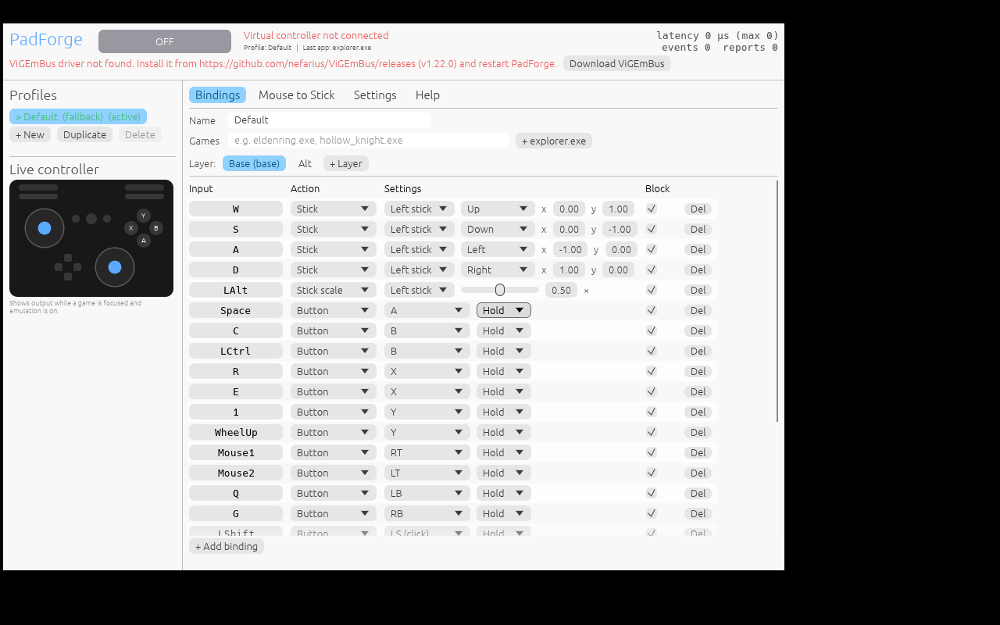

# PadForge

[](https://github.com/Azrael-opm/padforge/actions/workflows/ci.yml)

A lightweight, low-latency **keyboard & mouse → virtual controller** mapper for Windows, in the spirit of reWASD / Key2Joy.
Games see a real **Xbox 360 (XInput)** or **DualShock 4** controller while you play on mouse and keyboard.



## Features

- **Virtual Xbox 360 or DualShock 4** via the signed ViGEmBus driver
- **Mouse → stick** with velocity estimation, response curve, anti-deadzone, adaptive smoothing (works with 125 Hz – 8 kHz mice), release ramp, live curve preview
- **Hides mapped keys and mouse movement from the game**, so it stays in controller mode and doesn't flicker back to KB/M prompts
- **Profiles** with **auto-switching per game executable** and an optional "only emulate in listed games" mode
- **Layers** (hold/toggle, transparent fall-through), **turbo**, **toggle (latch)** buttons, **macros** (`tap a, wait 50, press rb, ...`, optional repeat-while-held), **walk modifier** (stick scale), analog trigger values, SOCD handling for WASD
- **Global toggle hotkey** (default **F8**). Emulation also pauses automatically while the PadForge window is focused
- Single portable `.exe` (~7 MB), config is a readable `padforge.toml` next to it
- **System tray**: the icon colour shows the state (green = emulating, amber = paused, grey = off). Left-click shows the window, right-click opens a menu (profile, enable, config folder, quit). Optional sound when toggling, useful in fullscreen games
- **Close to tray** and **start hidden in tray**
- `--headless` mode: tray only, no GUI, for the smallest footprint

## Install & run

1. Install **ViGEmBus 1.22.0** (one time): https://github.com/nefarius/ViGEmBus/releases
   It may already be installed if you use Steam Input or DS4Windows.
2. Download `padforge.exe` from [**Releases**](https://github.com/Azrael-opm/padforge/releases) (check it against the `.sha256` file if you like), or grab the build artifact from the latest [CI run](https://github.com/Azrael-opm/padforge/actions).
3. Run it. A default profile is created in `padforge.toml` next to the exe.
4. Focus your game and press **F8**. The status button and the tray icon turn green (**EMULATING**).

Closing the window keeps PadForge running in the tray (change this in **Settings**). Quit from the tray menu.

CLI flags:

| Flag | Effect |
|---|---|
| `--headless` | No window, tray icon only. When started from a terminal, logs go there and Ctrl+C quits |
| `--console` | With `--headless`: open a console window even when not started from a terminal |
| `--enable` | Start with emulation enabled |
| `--config <path>` | Use a different config file |

Set the environment variable `PADFORGE_DEBUG=1` to write a diagnostic log to `%TEMP%\padforge-debug.log`.

## Build

```bash
# On Windows (MSVC or GNU toolchain)
cargo build --release

# Cross-compile from Linux
rustup target add x86_64-pc-windows-gnu
sudo apt install gcc-mingw-w64-x86-64
cargo build --release --target x86_64-pc-windows-gnu

# Core unit tests (platform-neutral, run anywhere)
cargo test --lib
```

CI (GitHub Actions) runs clippy and the tests on Linux and Windows, and builds the release exe on every push.
Pushing a tag like `v0.2.0` publishes a GitHub release with the exe, its SHA-256 and the changelog notes.

## Architecture

```
 physical KB/M
      │
 ┌────▼─────────────────────────┐  input thread (TIME_CRITICAL priority)
 │ WH_KEYBOARD_LL / WH_MOUSE_LL │  - atomic loads + non-blocking send only
 │ Raw Input (INPUTSINK)        │  - swallow mapped inputs (block bitset)
 │ WinEvent foreground hook     │  - down/up pairing: no stuck keys ever
 └────┬─────────────────────────┘
      │ bounded lock-free channel (8192)
 ┌────▼─────────────────────────┐  engine thread (HIGHEST priority)
 │ Engine (pure Rust, tested)   │  - event driven, 0 % CPU when idle
 │  layers / turbo / macros     │  - timed wake-ups only while animating
 │  mouse→stick, profile select │  - 1 ms timer resolution only when needed
 └────┬─────────────────────────┘  - sends a report only when state changes
      │
 ┌────▼─────────────────────────┐
 │ ViGEmBus: X360 / DS4 target  │
 └──────────────────────────────┘
 GUI (egui/glow) and tray are woken by engine status events (no polling);
 20 Hz live view only while emulating and visible; no rendering at all while hidden in the tray.
```

| Module | Role |
|---|---|
| `src/engine.rs` | Mapping engine + 15 behaviour tests |
| `src/mouse_stick.rs` | Mouse-velocity → stick algorithm + tests |
| `src/pad.rs` | Controller model, exact XInput / DS4 report encoding + tests |
| `src/config.rs` | TOML config model, macro text format + tests |
| `src/keys.rs` | Virtual-key / mouse input ids and names |
| `src/shared.rs` | Lock-free state shared by hook, engine, GUI |
| `src/win/input.rs` | Hooks, Raw Input, foreground watcher |
| `src/win/vpad.rs` | ViGEmBus backend |
| `src/win/gui.rs` | egui interface |
| `src/win/tray.rs` | Tray icon, menu, notifications (raw `Shell_NotifyIcon`) |
| `src/icon.rs` | Procedurally drawn app/tray icon (no image files) |

## Config example

```toml
[settings]
toggle_hotkey = "F8"
controller = "xbox360"      # or "ds4"

[[profiles]]
name = "Elden Ring"
executables = ["eldenring.exe"]

[profiles.mouse]
target = "right"
sensitivity = 0.18
anti_deadzone = 0.2

[[profiles.layers]]
name = "Base"
binds = [
  { input = "W",      action = { type = "stick", stick = "left", x = 0.0, y = 1.0 } },
  { input = "Space",  action = { type = "button", button = "a" } },
  { input = "Mouse1", action = { type = "button", button = "rt" } },
  { input = "X",      action = { type = "button", button = "a", mode = "turbo", turbo_hz = 15 } },
  { input = "F",      action = { type = "macro", steps = [ { tap = "b" }, { wait = 60 }, { tap = "b" } ] } },
  { input = "CapsLock", action = { type = "layer", layer = "Alt" } },
]
```

Inputs: `A`–`Z`, `0`–`9`, `F1`–`F24`, `Space`, `LShift`, `LCtrl`, `LAlt`, `Tab`, `Escape`, arrows, numpad, `Mouse1`–`Mouse5`, `WheelUp/Down/Left/Right`, or `VK0x..`.
Buttons: `a b x y lb rb ls rs back start guide dpad_up/down/left/right touchpad lt rt`. PlayStation aliases also work (`cross circle square triangle l1 r1 l2 r2 l3 r3 share options ps`).

## Windows test checklist

The core logic is unit-tested and the app was smoke-tested under Wine (startup, GUI, config, focus detection).
These items need a real Windows PC:

1. **Driver:** with ViGEmBus installed, the header shows "Virtual Xbox 360 controller connected" and Windows plays the connect sound.
2. **Controller tester:** open https://hardwaretester.com/gamepad or `joy.cpl`, focus it, press F8, then check WASD, mouse, clicks and the live view.
3. **Blocking:** while emulating, mapped keys must not type in Notepad, and the cursor should freeze while the mouse drives the stick.
4. **Mouse source:** the left panel shows "Mouse source: raw input" or "hook". If it says hook and mouse feel varies with pointer speed, turn off Windows "Enhance pointer precision".
5. **No stuck keys:** hold W, press F8 (disable), release W. Notepad must not repeat `w` forever.
6. **Auto-profile:** add a game's exe to a profile; focusing the game should switch to it ("> name (active)").
7. **Resources:** Task Manager shows ~0 % CPU while idle, both with the window open and hidden in the tray. Memory is mostly the GUI (OpenGL); `--headless` is the minimal mode. (Under Wine every winit app busy-waits at ~50 % of a core, so this can only be measured on Windows.)
8. **Latency:** the header shows internal latency (event → driver), which should be in the tens of µs.
9. **Tray:** the icon turns green/amber/grey with F8 and focus changes. Closing the window hides it to the tray with a one-time notification; left-click brings it back; tray > Quit exits; restarting Explorer brings the icon back.

## Limitations / roadmap

- User-mode hooks can't tell multiple keyboards/mice apart. A per-device mode would need a filter driver (e.g. Interception).
- If a game reads Raw Input and Windows still delivers its mouse movement despite the hook swallowing it, the game sees both mouse and stick. Test item 4 reveals this.
- ViGEmBus is archived (still works, signed). Its successor (VirtualPad) can be added as a second backend behind the `Backend` trait.
- Planned: gyro/touchpad emulation for DS4, rumble passthrough, per-profile controller type, import of Key2Joy profiles.

## Fair play

PadForge doesn't try to hide from anti-cheat. Online and competitive games may ban controller emulation, especially for getting aim assist with a mouse.
Use it for single-player games, controller-only games, accessibility, and games that allow it.

## License

MIT
